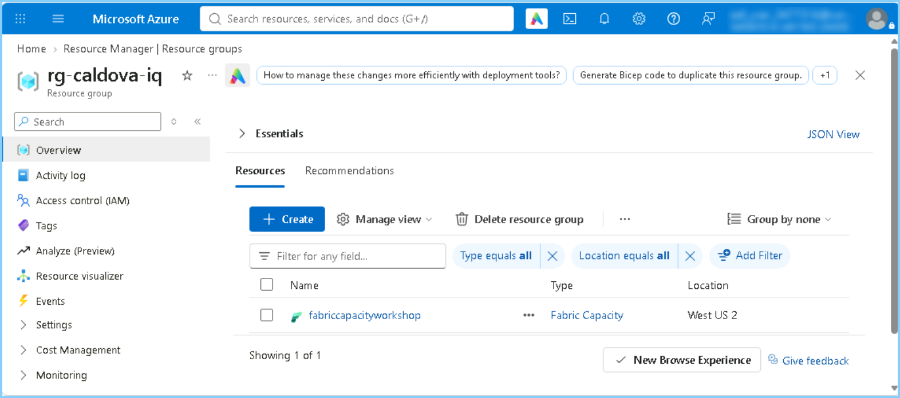

# Amplify IQ: Fabric capacity deployment

This folder creates only the foundational Fabric resources named in the Amplify IQ workshop README:

- Resource group `rg-caldova-iq` in **West US 2**
- One active **F16 Fabric capacity** named `fabriccapacity<ID>` in **West US 2**

It does not create a Fabric workspace, Lakehouse, sample data, Ontology, Fabric Data Agent, Foundry project, Azure AI Search, storage account, models, agents, or Copilot Studio resources.

## Before you start

You need:

- A local installation of [Azure CLI](https://learn.microsoft.com/cli/azure/install-azure-cli-windows).
- A service principal with permission to create `rg-caldova-iq` and an F16 Fabric capacity in the target subscription. **Contributor** at subscription scope is the practical minimum to create the new resource group; **Owner** is also suitable.
- A valid user UPN that can administer Fabric. The script adds this user and the deployment service principal as capacity administrators.

You do not need to run `az login` yourself. `up.ps1` authenticates Azure CLI with the service-principal values stored in `.env`.

## Configure `.env` locally

1. Open PowerShell or the VS Code integrated terminal at the cloned repository root.

   

2. Move to this deployment folder:

   ```powershell
   cd .\Amplify-Your-Intelligence\Amplify_Deployment
   ```

3. Create your local environment file from the safe template:

   ```powershell
   Copy-Item .env.example .env
   ```

4. Open `.env` in your editor and replace every placeholder. The completed file has this shape:

   ```dotenv
   AZURE_SUBSCRIPTION_ID=<your-azure-subscription-guid>
   AZURE_TENANT_ID=<your-microsoft-entra-tenant-guid>
   AZURE_CLIENT_ID=<your-service-principal-application-client-id>
   AZURE_CLIENT_SECRET=<your-service-principal-client-secret>
   AZURE_LOCATION=westus2
   FABRIC_CAPACITY_ADMIN_UPN=<user@yourtenant.onmicrosoft.com>
   FABRIC_CAPACITY_ID=<lowercase-letters-and-numbers-only>
   ```

5. Choose `FABRIC_CAPACITY_ID` carefully. It becomes part of the capacity name, exactly as stated in the workshop README:

   ```text
   FABRIC_CAPACITY_ID=workshop01
   fabriccapacityworkshop01
   ```

   Do not include spaces, hyphens, or special characters. Leave `AZURE_LOCATION=westus2` unchanged.

The `.env` file is ignored by Git and must remain local because it contains the client secret.

## Deploy

After saving `.env`, run this single command from `Amplify_Deployment`:

```powershell
.\up.ps1
```


The script performs the following sequence automatically:

1. Signs Azure CLI in as the configured service principal, or safely reuses the matching session.
2. Selects `AZURE_SUBSCRIPTION_ID`.
3. Creates or validates the `rg-caldova-iq` resource group in West US 2.
4. Deploys an F16 Fabric capacity named `fabriccapacity<ID>` in the same region.
5. Waits until the Fabric capacity reports `Active`.
6. Prints the completed resource group and capacity name.

Both the configured UPN and the deployment service principal are added as Fabric capacity administrators. The only resources the command creates or changes are the resource group and that Fabric capacity.


