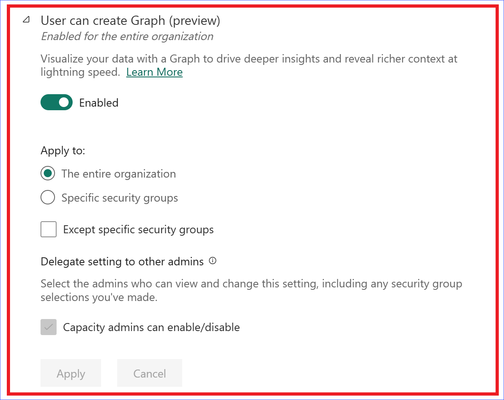
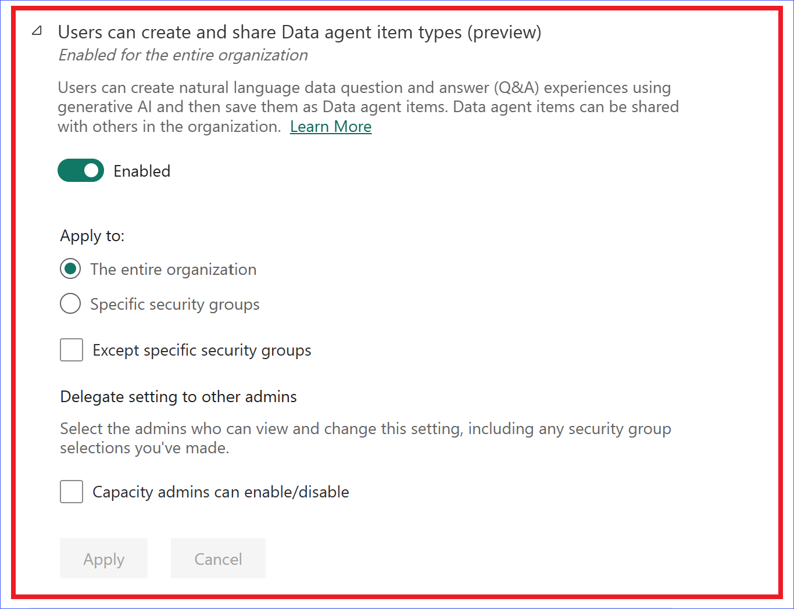

# Prerequisites

This document lists everything needed to run the **Microsoft IQ** exercises on your **own local machine and tenant.**

## What the exercises build

| Part | Built with | What gets created / used |
|------|-----------|--------------------------|
| **Fabric IQ** | GitHub Copilot → Fabric REST APIs (Python scripts) | Workspace `Caldova-Pharma-IQ<ID>` on the existing Fabric capacity; **Lakehouse** with 9 sample tables; **Ontology** (entities + relationships); **Fabric Data Agent** (tested and published) |
| **Foundry IQ & Web IQ** | GitHub Copilot → Bicep/ARM in **Sweden Central** | **Microsoft Foundry** resource + project; **gpt-5-mini** and **text-embedding-3-small** deployments; Storage container `caldova-documents` with 4 generated PDFs; **Azure AI Search** knowledge base `caldova-launch-kb`; **Web Search** tool limited to FDA/EMA URLs; **4 Foundry agents**; Fabric Data Agent attached through **Tools → Fabric IQ (OneLake Catalog)** |
| **Work IQ** | **Copilot Studio** (portal) | Main orchestrator agent in the **Default environment**; 4 Foundry agents connected as external agents; Fabric Data Agent connected; published to **Microsoft 365 and Microsoft Teams** |
---

## 1. Licenses

| License | Required? | Why |
|---------|-----------|-----|
| **Active Azure subscription** (Pay-As-You-Go / EA / CSP) | **Required** | Fabric capacity, Foundry, AI Search, Storage. It must be allowed to deploy **Azure OpenAI models in Sweden Central**. |
| **GitHub Copilot license** (Business / Enterprise) | **Required** | Agent mode builds everything. The guide uses **Claude Fable 5.1** with **High** thinking and **1M** context, so the GitHub org policy must allow this premium model and you need plenty of **premium requests**. |
| **Microsoft 365 E5** (with Teams) | **Required** | Base license for Teams, Exchange and SharePoint, which Work IQ uses. Also includes **Power BI Pro** for the accelerator's Power BI reports. In the EU/EEA and Switzerland, E5 is sold **without Teams**, so add **Microsoft Teams Enterprise**. |
| **Microsoft Copilot Studio** user license *(or a Copilot Studio capacity pack / pay-as-you-go billing on the environment)* | **Required** | To build and publish the main orchestrator agent. The environment also needs **Copilot Credits** (messages) so the agent can run in Teams. |
| **Microsoft 365 Copilot** | **Recommended** | Lets the agent use **Work IQ** tools (mail, meetings, Teams, documents). It also covers Copilot Studio use for building agents in Microsoft 365. |
| **Microsoft Fabric capacity** (paid **F SKU**) | **Required** | **The trial capacity is not enough.** Data Agents and Copilot need a paid F2 or higher. The lab uses **F16**, so plan for **F16 or higher** to keep Ontology and Data Agent responsive. |
| **Power BI Pro** | Included in E5 | View and edit the accelerator's Power BI reports on capacities below F64 |

---

## 2. Applications (local machine)

- **Visual Studio Code** (latest) 
- **GitHub Copilot** + **GitHub Copilot Chat** extensions
- **Git**

---

## 3. Resources / Services Required

### Pre-provision these (the prompts reuse them)

| Resource | Name in guide | Configuration notes |
|----------|---------------|---------------------|
| **Resource group** | `rg-caldova-iq` | Any region for Fabric. Foundry resources go to **Sweden Central**. |
| **Fabric capacity** (`Microsoft.Fabric/capacities`) | `fabriccapacity<ID>` | **F16 recommended**, state **Active (not paused)**. Your UPN (and SP, if used) is a **Capacity administrator**. |
| **Model** | — | **gpt-5-mini** (Global Standard) and **text-embedding-3-small** in your subscription |
| **Power Platform environment** | **Default** environment | Copilot Studio uses it. It must have **Copilot Studio capacity / credits**, and **DLP policies must allow** the *Azure AI Foundry Agent Service* and *Microsoft Fabric* connectors. |

## 4. Roles / Permissions / API Permissions

### Azure RBAC

| Role | Assign to | Scope | Why it's needed |
|------|-----------|-------|-----------------|
| **Owner** *(or Contributor + User Access Administrator)* | User | Subscription or `rg-caldova-iq` | Deploy Foundry, AI Search and Storage, and assign roles to their managed identities |
| **Contributor** | Service Principal | Subscription or `rg-caldova-iq` | Unattended deployment |
| **User Access Administrator (UAA)** | Service Principal | Subscription or `rg-caldova-iq` | Lets the SP grant roles between Foundry ↔ AI Search ↔ Storage |
| **Storage Blob Data Owner** *(Storage Blob Data Contributor is the minimum)* | User / SP | Subscription or the storage account | Upload PDFs to `caldova-documents`. Owner/Contributor alone gives **no data access**. |
| **Foundry Owner** (**Azure AI Owner**) *(or Azure AI Account Owner + **Azure AI User**)* | User / SP | Subscription or the Foundry resource | Create the Foundry project, deploy models, create and test agents, and add tools and knowledge. **Azure AI User** is the minimum to use the agent playground. |
| **Cognitive Services OpenAI User** | AI Search managed identity | Foundry resource | Run the embedding model during indexing and vectorization |
| **Search Service Contributor + Search Index Data Contributor** | User / SP | AI Search service | Create the index, indexer and knowledge base |
| **Search Index Data Reader** | Foundry project managed identity | AI Search service | Let agents query `caldova-launch-kb` |
| **Storage Blob Data Reader** | AI Search managed identity | Storage account | Read PDFs from Blob (Blob ingestion pattern) |
| **Capacity administrator** | User (+ SP) | Fabric capacity | Assign the new workspace to the capacity |
| **Workspace Admin** on `Caldova-Pharma-IQ<ID>` | User UPN | Requested in the prompt. Needed to create every item and to publish the Data Agent. |
| **User.Read.All** | Application | Service Principal | Turn the UPN into an object ID so it can be granted Fabric workspace Admin |

---

### Microsoft Graph API Permissions

| **Permission** | **Type** | **Grant To** | **Why** |
| -------------- | -------- | ------------ | ------- |
| **User.Read.All** | Application | Service Principal | Resolves the user's UPN to their Microsoft Entra ID object ID so that the user can be granted Fabric workspace Admin access. |
---

### Fabric tenant settings (Fabric Admin portal → Tenant settings)

A Fabric Administrator must turn these on once, for the whole organization or a security group that includes the user. Setting names may vary slightly as Fabric changes.

- **Ontology item (preview)** emabled on the tenant.

   

- **Data agent item types (preview)** enabled on the tenant.

    
---

## 6. Values to Have Ready

- Azure **subscription ID** and **tenant ID**
- Your **UPN** (workspace admin, Foundry and Copilot Studio connections)
- Names: `rg-caldova-iq`, `fabriccapacity<ID>`, workspace `Caldova-Pharma-IQ<ID>`
- **Foundry project endpoint** (copied from Foundry → Home) for the Copilot Studio connection
- **Agent IDs / names** of the 4 Foundry agents (from Copilot's deployment output)
- **GitHub username** with an active Copilot license, signed in to VS Code
---