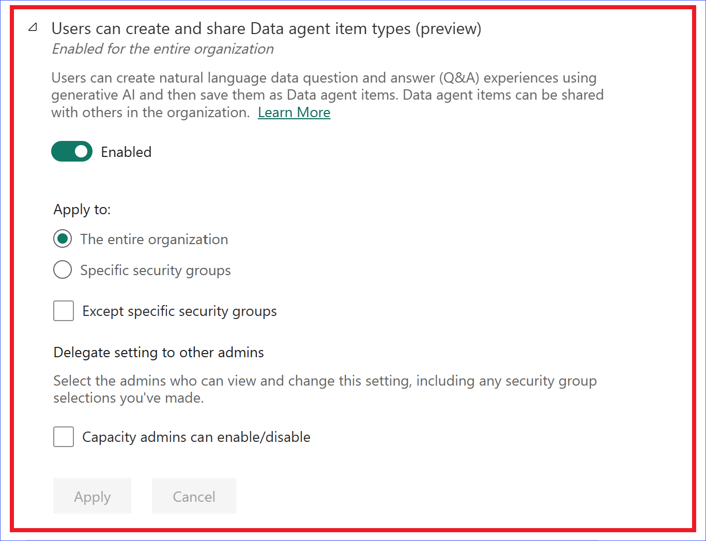

# Prerequisites

This document lists everything needed to run the **Unify Data – Rapid Prototyping using GitHub Copilot** exercises on your **own local machine and tenant**.

## What the exercises build

| Step | Scenario | What gets created / used |
|------|----------|--------------------------|
| 1 | **Fabric workspace** | New workspace `Caldova-Pharma<ID>` attached to the existing Fabric capacity; the user gets **Admin** access |
| 2 | **Analytical + operational data into OneLake** | `Caldova-Lakehouse`; **shortcuts** to CSV files in Blob Storage; **Fabric Mirroring** of the Azure SQL `OperationalData` database, with shortcuts into the Lakehouse |
| 3 | **Business application data** | New **Fabric SQL Database** (`Caldova_BusinessApp_SQLDB`); an **Azure Logic App** loads files from Blob Storage into it |
| 4 | **Semantic model, report & Data Agent** | **Direct Lake** semantic model with relationships; Power BI report built with **Copilot in Power BI**; **Fabric Data Agent** |
| 5 | **Govern & secure** | **OneLake Catalog**: Explore, Govern and Secure tabs |
| 6 | **Microsoft 365 Copilot** | Data Agent published to **Microsoft 365 Copilot** (`Caldova_Pharma_DataAgent`) and tested there |

---

## 1. Licenses & Subscriptions

| License / Subscription | Required? | Why |
|------------------------|-----------|-----|
| **Active Azure subscription** | **Required** | Hosts the Storage account, Azure SQL, Fabric capacity and Logic App |
| **GitHub Copilot license** (Business / Enterprise) | **Required** | Copilot Chat in **Agent mode** builds the Fabric and Azure components. The org must allow the **Claude Sonnet 5** model (or another premium model) and have enough **premium requests**. |
| **Microsoft Fabric capacity (F SKU, paid)** | **Required** | Workspace, Lakehouse, Mirroring, Fabric SQL DB, Direct Lake. **Copilot in Power BI and Fabric Data Agents need a paid F2 or higher capacity.** Trial capacities don't support them. **F64** is recommended so viewers don't need Pro licenses. |
| **Power BI Pro** (or Premium Per User) | **Required** | Lets the user create and save the semantic model and report in a workspace (on capacities below F64). It's **included in Microsoft 365 E5**. |
| **Microsoft 365 Copilot** | **Required** (Step 6) | Lets the user open the published Data Agent in Microsoft 365 Copilot |
| **Microsoft 365 E5** (or E3 + Power BI Pro) | **Required as the base license** | Qualifying base license for Microsoft 365 Copilot. E5 also includes Power BI Pro and Purview governance features. |
| **Microsoft Entra ID work account** (same tenant as Azure and Fabric) | **Required** | The UPN used for workspace admin, SQL access and mirroring |

---

## 2. Applications (local machine)

- **Visual Studio Code** (latest) 
- **GitHub Copilot** + **GitHub Copilot Chat** extensions
- **Git**

---

## 3. Resources / Services Required

### Pre-provision these (the prompts reuse them)

Use the **exact names** below or update the prompts to match. `<ID>` = your suffix, for example the deployment ID.

| Resource | Name in guide | Configuration notes |
|----------|---------------|---------------------|
| **Resource group** | `rg-Unified` | Same region as the Fabric capacity is recommended |
| **Storage account** | `storage<ID>` | StorageV2. **Hierarchical namespace (ADLS Gen2) recommended** so OneLake shortcuts work. Public access, or the storage firewall must allow Fabric (trusted workspace access). |
| **Container** | `data` | Folder `Analytical/` holds the **CSV files** for the Lakehouse shortcuts (e.g. DimDate). Folder `BusinessApplication/` holds the **customer files** for the Logic App (CustomerDetails, CustomerAddress). |
| **Azure SQL logical server** | `sql-operational-<ID>` | **Microsoft Entra authentication** on, with your UPN as **Entra admin**. **System-assigned managed identity turned on** (required for Fabric Mirroring). Firewall: **Allow Azure services** plus your client IP. Keep the SQL admin password handy, because Copilot may ask for it. |
| **Azure SQL Database** | `OperationalData` | Filled with operational tables (e.g. `Inventory`). Tables need **primary keys** for mirroring. Use a vCore or DTU tier that supports mirroring. Serverless works, but auto-pause can delay mirroring. |
| **Fabric capacity** (Azure resource `Microsoft.Fabric/capacities`) | `fabriccapacity<ID>` | **F2 or higher, Running (not paused)**. Your UPN is listed as a **Capacity administrator**. |

### Data 

Before starting prototyping, you should have source data in our blob storage account which is created above to process.

Below are the different types of source data
 - Business Appplication Data:
    - *storage account :`storage<ID>`-> container :`data`-> folder: `Business Application`*-> Upload Documents
 - Analytical Data
    - *storage account :`storage<ID>`-> container :`data`-> folder: `Analytical`*-> Upload Documents
---

## 4. Roles / Permissions / API Permissions

### Azure RBAC

| Role | Assign to | Scope | Why it's needed |
|------|-----------|-------|-----------------|
| **Owner** *(or Contributor + User Access Administrator)* | User | Subscription or `rg-Unified` | Deploy the Logic App, API connections and integration resources; assign roles to managed identities |
| **Contributor** | Service Principal *(if used)* | Subscription or `rg-Unified` | Deploy resources without user interaction |
| **User Access Administrator (UAA)** | Service Principal *(if used)* | Subscription or `rg-Unified` | Grant the Logic App and Fabric identities access to Storage and SQL |
| **Storage Blob Data Owner** *(Storage Blob Data Contributor is the minimum)* | User / SP | Storage account (subscription works too) | Read CSV files for the shortcuts and give the Logic App access to the business application files. **Note:** Owner/Contributor alone does **not** give data access. |
| **Storage Blob Data Reader** | Logic App managed identity, plus Fabric workspace identity if used for the shortcut | Storage account | Lets the Logic App and shortcuts read the files |
| **Capacity administrator** | User (and SP if used) | Fabric capacity `fabriccapacity<ID>` | Assign the new workspace to the capacity |

### Fabric tenant settings (Fabric Admin portal → Tenant settings)

A **Fabric Administrator** must turn these on once, for the whole organization or a security group that includes the user. Setting names may vary slightly as Fabric changes.

1. **Data agent item types (preview)** enabled on the tenant.

2. Navigate to [Fabric](app.powerbi.com). Click on **Settings** and select **Admin portal**.

3. Enable **Data agent item types (preview)**.

    

### Microsoft 365 admin

- Microsoft 365 Copilot license assigned to the user
- Agents allowed in the **Microsoft 365 admin center → Integrated apps / Agents** policy, so the published Data Agent shows under **Agents → Your agents**

---

## 5. Values to Have Ready

-  Azure **subscription ID** and **tenant ID**
-  Your **UPN** (workspace admin, SQL connection)
- **SQL admin password** for `sql-operational-<ID>`.
- Names: `rg-Unified`, `storage<ID>`, container `data`, `fabriccapacity<ID>`, `sql-operational-<ID>`, `OperationalData`
- **GitHub username** with an active Copilot license, signed in to VS Code
---
