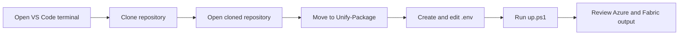
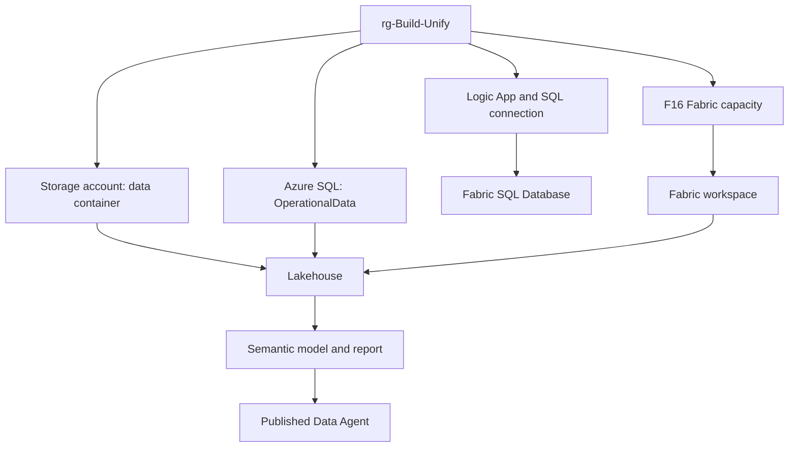

# Unify-Package deployment guide

`Unify-Package` validates the bundled source files, provisions the Azure and Fabric foundation, loads the three source domains, and creates the governed Fabric analytics artifacts.

## Run from the VS Code integrated terminal

1. Start **Visual Studio Code** and select **Terminal** → **New Terminal**.
2. In the VS Code terminal, choose a parent folder for the repository, clone it once, and open the clone in VS Code:

```powershell
New-Item -ItemType Directory -Path "C:\Repos" -Force | Out-Null
Set-Location "C:\Repos"
git clone https://github.com/TechExperiences/Sellers-Customer-Technical-Workshops.git
Set-Location ".\Sellers-Customer-Technical-Workshops"
code .
```

3. In the VS Code window opened for the clone, select **Terminal** → **New Terminal** again. Move to this package folder, create `.env` if it does not exist, and open it for editing:

```powershell
Set-Location ".\Build-a-unified-governed-data-and AI-estate\Unify-Package"
if (-not (Test-Path .env)) { Copy-Item .env.example .env }
code .env
```

4. Enter the required `.env` values, save the file, return to the same terminal, and run the one deployment command:

```powershell
.\up.ps1
```



## 1. Confirm the local tools and source folders

Use PowerShell 7 with Azure CLI (`az`), Azure Developer CLI (`azd`), Python 3, and `winget` available in the terminal. Keep the supplied `Analytical`, `Operational`, and `BusinessApplication` folders beside `up.ps1`; the pipeline validates and uploads their contents.

## Enable Azure resource providers

In Azure portal, open **Subscriptions** → select the deployment subscription → **Resource providers**. Register these namespaces if their status is not **Registered**:

- `Microsoft.Fabric`
- `Microsoft.Storage`
- `Microsoft.Sql`
- `Microsoft.Logic`
- `Microsoft.Web`

Or run:

```powershell
az provider register --namespace Microsoft.Fabric --wait
az provider register --namespace Microsoft.Storage --wait
az provider register --namespace Microsoft.Sql --wait
az provider register --namespace Microsoft.Logic --wait
az provider register --namespace Microsoft.Web --wait
```

## 2. Open this deployment folder

Set `$repoRoot` to the folder where you cloned `Sellers-Customer-Technical-Workshops`, then run:

```powershell
$repoRoot = "C:\path\to\Sellers-Customer-Technical-Workshops"
Set-Location (Join-Path $repoRoot "Build-a-unified-governed-data-and AI-estate\Unify-Package")
Get-Location
```

## 3. Create and edit `.env`

Create `.env` in this `Unify-Package` folder, beside `up.ps1`. Keep this local file private and do not commit it.

```powershell
Copy-Item .env.example .env
notepad .env
```

Replace the placeholders:

```dotenv
AZURE_ENV_NAME=unify-local
AZURE_SUBSCRIPTION_ID=<YOUR_SUBSCRIPTION_ID>
AZURE_TENANT_ID=<YOUR_TENANT_ID>
AZURE_LOCATION=westus2
AZURE_RESOURCE_GROUP=rg-Build-Unify
FABRIC_CAPACITY_ADMIN_UPN=<YOUR_USER_PRINCIPAL_NAME>
SQL_ADMINISTRATOR_LOGIN=squnify
SQL_ADMINISTRATOR_PASSWORD=<STRONG_SQL_PASSWORD>
```

| Entry | Value |
|---|---|
| `AZURE_ENV_NAME` | Local Azure Developer CLI environment name, for example `unify-local`. |
| `AZURE_SUBSCRIPTION_ID` | Subscription GUID for the new Azure and Fabric resources. |
| `AZURE_TENANT_ID` | Microsoft Entra tenant GUID for the deployment account. |
| `AZURE_LOCATION` | Keep `westus2`. |
| `AZURE_RESOURCE_GROUP` | Keep `rg-Build-Unify`. |
| `FABRIC_CAPACITY_ADMIN_UPN` | Fabric user principal name that becomes capacity and workspace administrator. |
| `SQL_ADMINISTRATOR_LOGIN` | SQL authentication administrator name. |
| `SQL_ADMINISTRATOR_PASSWORD` | Strong password for the new Azure SQL Server. |

## 4. Run the complete deployment

Save `.env`, remain in this folder, then run:

```powershell
Set-Location (Join-Path $repoRoot "Build-a-unified-governed-data-and AI-estate\Unify-Package")
.\up.ps1
```

The command checks Azure CLI authentication, installs ODBC Driver 18 when necessary, imports `.env` into the selected Azure Developer CLI environment, validates the source data, and runs `azd up --no-prompt`.



## What is created

| Area | Created artifacts |
|---|---|
| Azure foundation | `rg-Build-Unify`; Storage account with private `data` container; a new Azure SQL Server and `OperationalData` database; F16 Fabric capacity. |
| Integration | `caldova-integration-account`, `caldova-businessapp-ingest` Logic App, and managed-identity SQL API connection. |
| Fabric | `Caldova-Build-Unify-<stable-suffix>` workspace, `Caldova_Lakehouse`, `Caldova_SQLDatabase`, ingestion notebook, semantic model, report, and Data Agent. |

## Verify the result

- **Azure portal** → **Resource groups** → `rg-Build-Unify` for Storage, generated SQL Server, Fabric capacity, Logic App, Integration Account, and API connection.
- **Microsoft Fabric** → **Workspaces** → `Caldova-Build-Unify-<stable-suffix>` for the Lakehouse, Fabric SQL Database, notebook, semantic model, report, and Data Agent.
- **Fabric Lakehouse** → **Tables** for the unified Delta tables.
