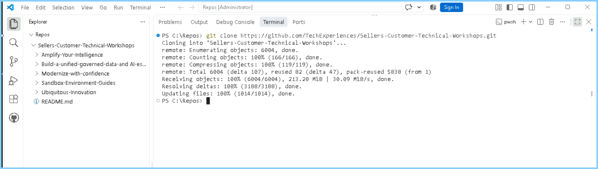
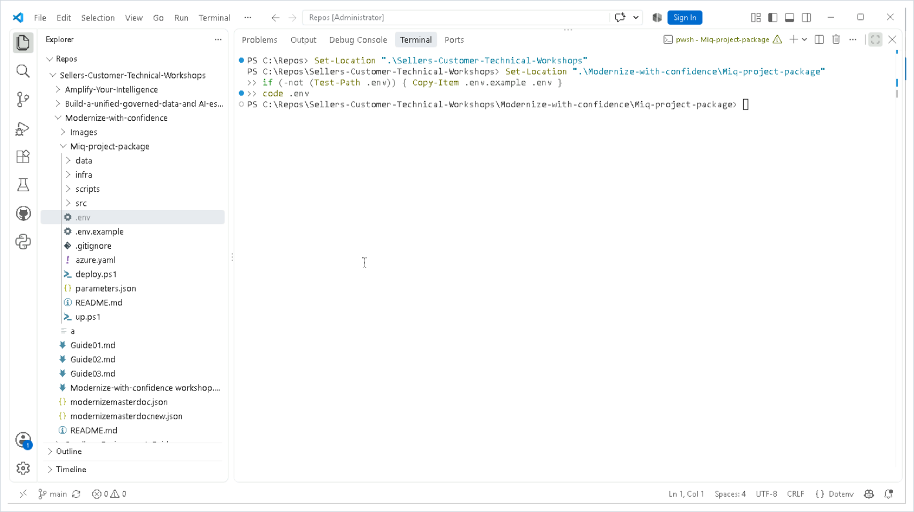

# Miq-project-package deployment guide

`Miq-project-package` provisions the Caldova modernization demo, migrates the bundled local CSV data to Azure SQL, creates vector embeddings, and publishes the ASP.NET Core web application.

## Run from the VS Code integrated terminal

1. Start **Visual Studio Code** and select **Terminal** → **New Terminal**.
2. In the VS Code terminal, choose a parent folder for the repository, clone it once, and open the clone in VS Code:

```powershell
New-Item -ItemType Directory -Path "C:\Repos" -Force | Out-Null
Set-Location "C:\Repos"
git clone https://github.com/TechExperiences/Sellers-Customer-Technical-Workshops.git
Set-Location ".\Sellers-Customer-Technical-Workshops"
code .
```



3. In the VS Code window opened for the clone, select **Terminal** → **New Terminal** again. Move to this package folder, create `.env` if it does not exist, and open it for editing:

```powershell
Set-Location ".\Modernize-with-confidence\Miq-project-package"
if (-not (Test-Path .env)) { Copy-Item .env.example .env }
code .env
```



4. Enter the required `.env` values, save the file, return to the same terminal, and run the one deployment command:

```powershell
.\up.ps1
```

## 1. Confirm the local tools and source data

Use PowerShell 7 with Azure CLI (`az`), Azure Developer CLI (`azd`), and Git available in the terminal. The .NET 10 SDK is used when already installed; if it is missing, the pipeline downloads it automatically into the package-local `.dotnet` folder (no admin rights required). Keep the supplied CSV files in `data`; the pipeline imports eleven source tables and generates the embeddings table itself.

The local CSVs are a **simulated on-premises export**. The package does not connect to an on-premises VM and does not store source-system credentials.

## Deployment regions

The deployment automatically tries the listed regions in order when a resource cannot be created in an earlier region. The final terminal output reports the exact region selected for each workload.

| Resource or workload | Region selection |
|---|---|
| Resource group `rg-MWC` | First available of **West US 2**, **West US**, **East US**, then **East US 2**. Its location is retained on later runs. |
| Azure SQL logical server and `CaldovaOrderManagement` database | First available of **West US 2**, **West US**, **East US**, then **East US 2**. |
| App Service plan and web app | First available of **West US 2**, **West Central US**, **West US**, **East US**, then **East US 2**. |
| Azure OpenAI account and its chat/embedding model deployments | **West US** (`westus`) only. |
| Azure Developer CLI subscription deployment record | **West US 2** only; it is deployment metadata, not an application resource. |

## Enable Azure resource providers

In Azure portal, open **Subscriptions** → select the deployment subscription → **Resource providers**. Register these namespaces if their status is not **Registered**:

- `Microsoft.Sql`
- `Microsoft.Web`
- `Microsoft.CognitiveServices`

Or run:

```powershell
az provider register --namespace Microsoft.Sql --wait
az provider register --namespace Microsoft.Web --wait
az provider register --namespace Microsoft.CognitiveServices --wait
```

## 2. Open this deployment folder

Set `$repoRoot` to the folder where you cloned `Sellers-Customer-Technical-Workshops`, then run:

```powershell
$repoRoot = "C:\path\to\Sellers-Customer-Technical-Workshops"
Set-Location (Join-Path $repoRoot "Modernize-with-confidence\Miq-project-package")
Get-Location
```

## 3. Create and edit `.env`

Create `.env` in this `Miq-project-package` folder, beside `up.ps1`. Keep it local and do not commit it.

```powershell
Copy-Item .env.example .env
notepad .env
```

Set these required values:

```dotenv
AZURE_SUBSCRIPTION_ID=<SUBSCRIPTION_GUID>
SQL_ADMINISTRATOR_PASSWORD=<STRONG_SQL_ADMIN_PASSWORD>
SQL_ENTRA_ADMIN_LOGIN=<MICROSOFT_ENTRA_ADMIN_UPN>
SQL_ENTRA_ADMIN_OBJECT_ID=<MICROSOFT_ENTRA_ADMIN_OBJECT_ID>
```

| Entry | Value |
|---|---|
| `AZURE_SUBSCRIPTION_ID` | Target Azure subscription GUID. |
| `SQL_ADMINISTRATOR_PASSWORD` | Strong password for the new SQL logical server. |
| `SQL_ENTRA_ADMIN_LOGIN` | Microsoft Entra administrator UPN for the new SQL server. |
| `SQL_ENTRA_ADMIN_OBJECT_ID` | Object ID for the same Entra administrator. |
| `AZURE_ENV_NAME` | Optional local Azure Developer CLI environment name. |
| `SQL_ADMINISTRATOR_LOGIN` | Optional SQL authentication login; `sqladmincaldova` is the default. |
| `SQL_MIGRATION_CLIENT_IP` | Optional public IP for the migration; the pipeline detects it when left blank. |
| `AZURE_CLIENT_ID`, `AZURE_TENANT_ID`, `AZURE_CLIENT_SECRET` | Set all three only for service-principal sign-in. |

## 4. Run the complete deployment

Save `.env`, remain in this folder, then run:

```powershell
Set-Location (Join-Path $repoRoot "Modernize-with-confidence\Miq-project-package")
.\up.ps1
```

`up.ps1` loads `.env`, creates or selects the local Azure Developer CLI environment, saves the subscription ID and its required `AZURE_LOCATION=westus2` deployment record, then runs `azd up --no-prompt`. That Azure Developer CLI location does not change the independent workload region-selection rules described above.

For unattended sign-in, provide `AZURE_CLIENT_ID`, `AZURE_TENANT_ID`, and `AZURE_CLIENT_SECRET` in `.env`. Otherwise, Azure authentication may open an interactive sign-in prompt.

For an unattended service-principal run, the pipeline temporarily makes that service principal the Azure SQL Microsoft Entra administrator for the migration and web-app database setup. It restores the user configured by `SQL_ENTRA_ADMIN_LOGIN` and `SQL_ENTRA_ADMIN_OBJECT_ID` before completion.

## What is created

| Area | Created artifacts |
|---|---|
| Azure foundation | `rg-MWC`; `app-caldova-ordermgmt-<deployment-suffix>` App Service; `plan-caldova-ordermgmt` App Service plan; `sql-caldova-<deployment-suffix>` and `CaldovaOrderManagement`; and `openai-caldova-<deployment-suffix>`. |
| Azure OpenAI | `gpt-5-mini` chat deployment and `text-embedding-ada-002` embedding deployment. |
| Data modernization | Eleven imported source tables plus generated `dbo.ProductDescriptionEmbeddings` with native `VECTOR(1536)` embeddings. |
| Web application | Published ASP.NET Core MVC UI with dashboard, availability, keyword and semantic search, customer lookup, stock-validated order creation, and order lookup. |

The deployment sets the supplied Microsoft Entra administrator on Azure SQL, creates a temporary deployment-client firewall rule, imports the eleven CSV exports from `data/`, verifies source-table counts, generates embeddings, and removes the temporary firewall rule afterward. It grants the App Service managed identity database access and allows its outbound IPs through SQL firewall rules.

`data/ProductDescriptionEmbeddings.csv` is deliberately excluded from initial import. The generated twelfth table demonstrates the AI modernization phase by using the imported product, category, and description data.

## Verify the result

- **Azure portal** → **Resource groups** → `rg-MWC` for the App Service plan/web app, SQL server/database, and Azure OpenAI account.
- Open the generated `https://app-caldova-ordermgmt-<suffix>.azurewebsites.net` URL printed at completion.
- In Azure SQL, verify `CaldovaOrderManagement` and `dbo.ProductDescriptionEmbeddings`.

## Additional deployment details

The Semantic Search page compares traditional SQL keyword matches with meaning-based matches. It embeds the question with `text-embedding-ada-002`, ranks `ProductDescriptionEmbeddings` with cosine distance in Azure SQL, and asks `gpt-5-mini` for a concise catalog-grounded answer. The deployment does not use a VNet: SQL remains on its public endpoint, restricted by firewall rules. The App Service uses its managed identity; no SQL or Azure OpenAI secret is stored in the application.

The resource group location cannot change after creation. App Service plus plan, SQL server plus database, and Azure OpenAI account plus both model deployments are co-located within their individual deployment groups. If a regional attempt partially creates one of those groups and fails, the script removes those generated resources before trying the next supported region. Azure OpenAI has no fallback; a West US failure stops the deployment rather than placing the models elsewhere.

Every deployment run creates a random eight-character suffix for the App Service, SQL logical server, and Azure OpenAI account. The ignored `.deployment-state.json` file records that run's names for post-provisioning. Earlier failed resources are not reused or deleted automatically; remove them manually when no longer needed to avoid charges.

The subscription needs Azure OpenAI quota for `gpt-5-mini` and `text-embedding-ada-002` in West US. The template requests 10 Standard capacity units (normally 10K TPM) for `text-embedding-ada-002`; deployment cannot create or increase quota. Azure OpenAI deployments are created serially because the control plane permits one deployment operation at a time per account and transient conflicts are retried for up to six minutes.

The starter configuration enables public network access for SQL and Azure OpenAI so the migration can run from the deployment client. Use Private Link/VNet integration for production app-to-SQL connectivity. The direct `deploy.ps1 -SubscriptionId '<your-subscription-id>'` path remains available for Azure CLI-only deployments and prompts securely for the SQL administrator password when that value is not supplied.
