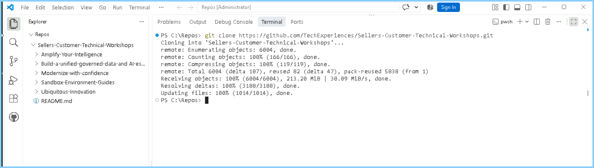
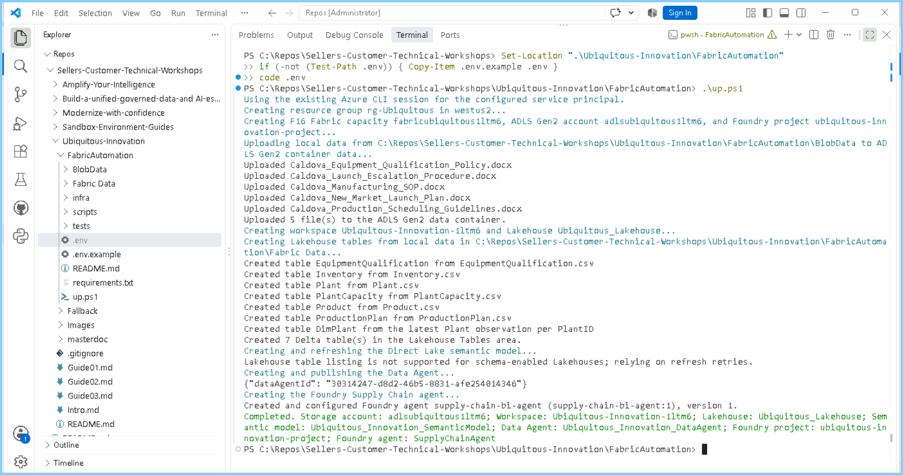
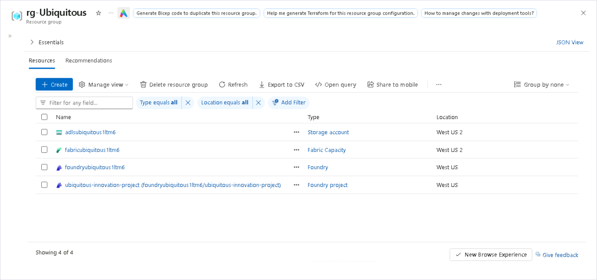
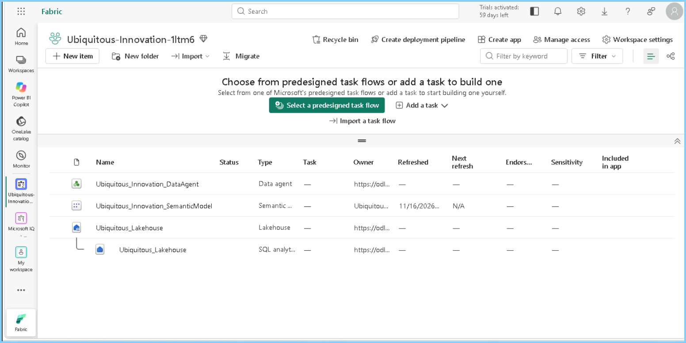
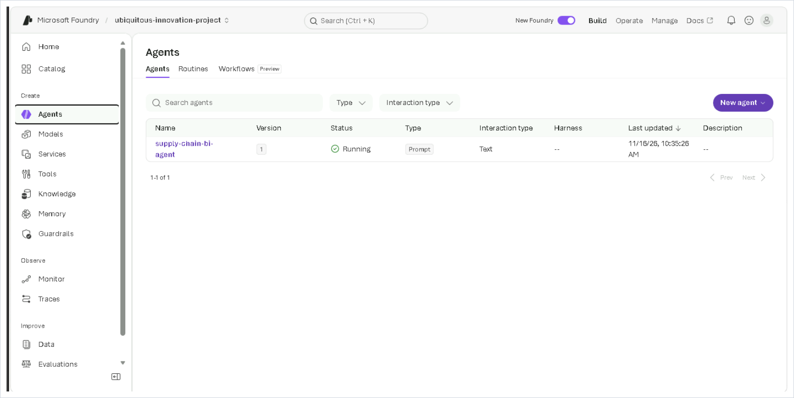
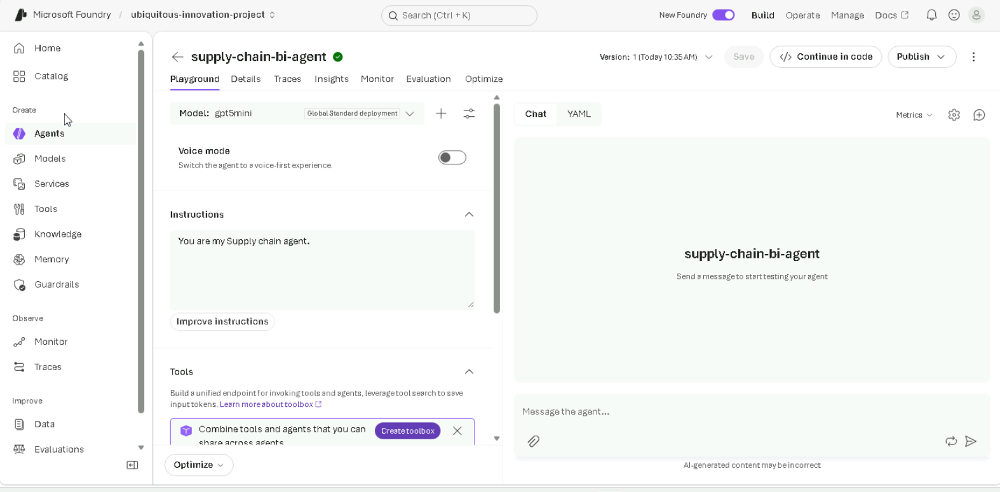

# FabricAutomation deployment guide

`FabricAutomation` validates the bundled CSV and document files, provisions the Azure and Fabric foundation, creates the Lakehouse analytics artifacts, and deploys the Supply Chain Foundry agent.

## Run from the VS Code integrated terminal

1. Start **Visual Studio Code** and select **Terminal** → **New Terminal**.
2. In the VS Code terminal, choose a parent folder for the repository, clone it once, and open the clone in VS Code:

```powershell
New-Item -ItemType Directory -Path "C:\Repos" -Force | Out-Null
Set-Location "C:\Repos"
git clone https://github.com/TechExperiences/Sellers-Customer-Technical-Workshops-Packages.git
Set-Location ".\Sellers-Customer-Technical-Workshops-Packages"
code .
```



3. In the VS Code window opened for the clone, select **Terminal** → **New Terminal** again. Move to this package folder, create `.env` if it does not exist, and open it for editing:

```powershell
Set-Location ".\Ubiquitous-Innovation\FabricAutomation"
if (-not (Test-Path .env)) { Copy-Item .env.example .env }
code .env
```

4. Enter the required `.env` values, save the file, return to the same terminal, and run the one deployment command:

```powershell
.\up.ps1
```



## 1. Confirm the local tools and source folders

Use PowerShell 7 with Azure CLI (`az`) and Python 3 available in the terminal. Keep the supplied source folders beside `up.ps1`:

- `Fabric Data` — the six CSV files used to create Lakehouse tables.
- `BlobData` — one or more files to upload to the new ADLS Gen2 `data` container.

The subscription must be able to create the F16 capacity in West US 2 and the Foundry model deployments in West US.

## Deployment regions

| Resource or workload | Region |
|---|---|
| Resource group `rg-Ubiquitous` | `AZURE_LOCATION` from `.env`; set to **West US 2** (`westus2`) in this guide. |
| F16 Fabric capacity, ADLS Gen2 account, and `data` container | **West US 2** — they use `AZURE_LOCATION`. |
| Fabric workspace, Lakehouse, Delta tables, semantic model, and Data Agent | **West US 2** — these are created on the West US 2 Fabric capacity. |
| Foundry hub, Foundry project, and all Foundry model deployments (`gpt-5-mini`, `gpt-5.4`, and `text-embedding-3-small`) | **West US** (`westus`) — this is fixed in the infrastructure, independent of `AZURE_LOCATION`. |

## Enable Azure resource providers

In Azure portal, open **Subscriptions** → select the deployment subscription → **Resource providers**. Register these namespaces if their status is not **Registered**:

- `Microsoft.Fabric`
- `Microsoft.Storage`
- `Microsoft.CognitiveServices`

Or run:

```powershell
az provider register --namespace Microsoft.Fabric --wait
az provider register --namespace Microsoft.Storage --wait
az provider register --namespace Microsoft.CognitiveServices --wait
```

## 2. Open this deployment folder

Set `$repoRoot` to the folder where you cloned `Sellers-Customer-Technical-Workshops-Packages`, then run:

```powershell
$repoRoot = "C:\path\to\Sellers-Customer-Technical-Workshops-Packages"
Set-Location (Join-Path $repoRoot "Ubiquitous-Innovation\FabricAutomation")
Get-Location
```

## 3. Create and edit `.env`

Create `.env` in this `FabricAutomation` folder, beside `up.ps1`. Keep it local and do not commit it.

```powershell
Copy-Item .env.example .env
notepad .env
```

Enter these values:

```dotenv
AZURE_SUBSCRIPTION_ID=<SUBSCRIPTION_GUID>
AZURE_TENANT_ID=<TENANT_GUID>
AZURE_CLIENT_ID=<SERVICE_PRINCIPAL_APPLICATION_CLIENT_ID>
AZURE_CLIENT_SECRET=<SERVICE_PRINCIPAL_CLIENT_SECRET>
AZURE_LOCATION=westus2
AZURE_RESOURCE_GROUP=rg-Ubiquitous
FABRIC_CAPACITY_ADMIN_UPN=<USER_UPN_TO_ADMINISTER_THE_CAPACITY_AND_WORKSPACE>
```

| Entry | Value |
|---|---|
| `AZURE_SUBSCRIPTION_ID` | Azure subscription GUID for the deployment. |
| `AZURE_TENANT_ID` | Microsoft Entra tenant GUID. |
| `AZURE_CLIENT_ID` / `AZURE_CLIENT_SECRET` | Application ID and active secret for the deployment service principal. |
| `AZURE_LOCATION` | Keep `westus2`. |
| `AZURE_RESOURCE_GROUP` | Keep exactly `rg-Ubiquitous`. |
| `FABRIC_CAPACITY_ADMIN_UPN` | User principal name that administers the created capacity and workspace. |

## 4. Run the complete deployment

Save `.env`, remain in this folder, then run:

```powershell
Set-Location (Join-Path $repoRoot "Ubiquitous-Innovation\FabricAutomation")
.\up.ps1
```

The script uses the configured service principal for non-interactive Azure CLI sign-in. If Azure CLI is already signed in as that exact application in the configured tenant, it reuses the existing session; otherwise it signs in silently.

## What is created

| Area | Created artifacts |
|---|---|
| Azure foundation | `rg-Ubiquitous`; F16 Fabric capacity with a random five-character alphanumeric suffix; ADLS Gen2 account `adlsubiquitous<suffix>` with private `data` container. |
| Fabric | Paired `Ubiquitous-Innovation-<suffix>` workspace; schema-enabled Lakehouse; six CSV-based Delta tables plus `dbo.DimPlant`; `Ubiquitous_Innovation_SemanticModel`; and published `Ubiquitous_Innovation_DataAgent`. |
| Foundry | One Azure AI Foundry account and `ubiquitous-innovation-project`; `gpt5mini` (`gpt-5-mini`, `2025-08-07`), standalone `gpt-5.4`, and standalone `text-embedding-3-small` deployments; and `supply-chain-bi-agent`. |

The `Fabric Data` folder is read locally. Each CSV is written once as a Delta table in the new Lakehouse **Tables** area; the CSV files are not uploaded to **Files**. The pipeline derives `dbo.DimPlant` from the latest observation for each `PlantID`, so the semantic model can use `Plant` as a unique dimension.

The `BlobData` folder is uploaded recursively to the `data` container. Both source paths are resolved from the project directory, so the project can be copied to a VM without hardcoded user paths.

## Verify the result

- **Azure portal** → **Resource groups** → `rg-Ubiquitous` for the Fabric capacity, storage account, and Foundry resource.

  

- **Microsoft Fabric** → **Workspaces** → `Ubiquitous-Innovation-<suffix>` for `Ubiquitous_Lakehouse`, `Ubiquitous_Innovation_SemanticModel`, and `Ubiquitous_Innovation_DataAgent`.

  

- **Microsoft Foundry** → `ubiquitous-innovation-project` for the model deployments and `supply-chain-bi-agent`.

  

  

## Additional deployment details

The workflow is creation-only and stops if `rg-Ubiquitous` already exists. The Foundry agent uses the instruction `You are my Supply chain agent.` Its endpoint enables the Responses and Activity protocols with Entra and Bot Service RBAC authorization schemes.

`FABRIC_CAPACITY_ADMIN_UPN` is added as a capacity administrator and workspace `Admin`, so that user can see and open the new workspace normally in the Fabric portal. The service principal creates the workspace and Lakehouse.

The semantic model contains the six Lakehouse `dbo` tables and their Product/Plant relationships. It is refreshed after creation so the published Data Agent can query it. No report is created.

The deployment identity needs Azure RBAC that permits it to create the resource group, Fabric capacity, storage account, Foundry account/project/model deployments, and required role assignments (for example, Owner or Contributor plus User Access Administrator). The subscription needs `gpt-5-mini` Global Standard quota in West US, and the Fabric tenant must permit service principals to use Fabric APIs. For Direct Lake refresh, grant the Power BI Service **Application** permission `Dataset.ReadWrite.All` with tenant admin consent. Microsoft Graph **Application** permission `User.Read.All` with tenant admin consent is required only to resolve `FABRIC_CAPACITY_ADMIN_UPN` before adding the user to the workspace. The project does not check or assign licenses.

The pipeline grants `Storage Blob Data Contributor` only to the service principal on its newly created storage account, and grants `Foundry User` only on the new Foundry project to both the service principal and `FABRIC_CAPACITY_ADMIN_UPN`.
