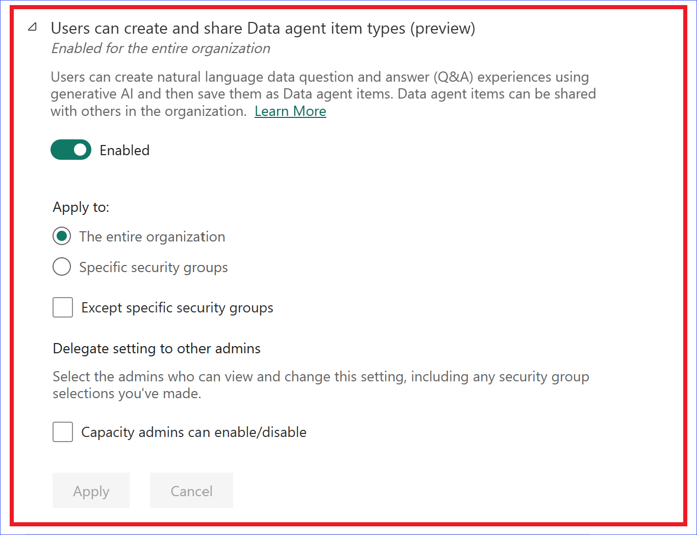

# Prerequisites

This document lists everything needed to run the **Ubiquitous Innovation – Rapid Prototyping** exercises on your **own local/vm machine and Azure tenant.**

## What the exercises cover

| Topic | Activities | Built / used with |
|-------|------------|-------------------|
| **1 – Build agents and software at the speed of AI** | Clone repo → `Design-Review.md` in **Plan** mode → push to `main` → pick a model (`/model`, `/model auto`) in the **GitHub Copilot app** → `/delegate` to the **coding agent** → draft PR → **Copilot code review** → `@copilot` fixes → merge | VS Code + GitHub Copilot Chat, **GitHub Copilot app**, GitHub repo |
| **2 – Agents that know your business** | Check the existing `supply-chain-bi-agent` → change the model to **GPT-5.4** → add the **Fabric Data Agent** (Fabric IQ tool) → **Foundry IQ** knowledge base from Blob (AI Search + `text-embedding-3-small`) → **SharePoint (Work IQ)** tool → **Evaluation** | Microsoft Foundry, Fabric, Azure AI Search, SharePoint |
| **3 – From one agent to a coordinated system** | New **Developer environment with Dataverse** → **Copilot Studio** agent built with the *GitHub Copilot* option ("Market Launch Coordinator") → connect the Foundry agent → **Skill** → publish to **Teams + Microsoft 365** → **Workflow** triggered by Outlook *When a new email arrives* | Power Platform admin center, Copilot Studio, Teams, Outlook |
| **4 – Trust and cost are the same conversation** | **Agent 365** (All agents, agent map, Details, Data & tools, Activity, Permissions and Security tabs) → Entra / Purview / Foundry guardrails / Defender review → **Purview** Compliance Manager, Data Security Investigations, DLP analytics → **M365 admin center Billing** | Microsoft 365 admin center, Entra, Purview, Defender |

---

## 1. Licenses

| License | Required? | Why |
|---------|-----------|-----|
| **Active Azure subscription** | **Required** | Foundry, AI Search, Storage, Fabric capacity. It must allow **GPT-5.4** and **text-embedding-3-small** deployments (check region availability and quota). |
| **GitHub Copilot license** – **Business or Enterprise** (Pro+ for individuals) | **Required** | Agent and Plan mode, the **Copilot coding agent** (`/delegate`), **Copilot code review** and `@copilot` PR comments. The org policy must turn on the **coding agent** and the premium models (**Claude Sonnet 5**, Auto/Fusion). |
| **Microsoft 365 E5** (with Teams) | **Required** | Exchange (email trigger), SharePoint, Teams, **Purview** (Compliance Manager, DLP, DSPM for AI) and **Defender for Cloud Apps** |
| **Microsoft 365 Copilot** | **Required** | The Foundry **SharePoint (Work IQ)** tool needs a Microsoft 365 Copilot license for the signed-in user. It also gives Work IQ context in Copilot Studio and access to the agent in Microsoft 365 Copilot. |
| **Microsoft Copilot Studio** user license + **Copilot Studio capacity / Copilot Credits** (or pay-as-you-go on the environment) | **Required** | Build, publish and run the Market Launch Coordinator, its skill and the workflow |
| **Microsoft Agent 365** | **Required** (Topic 4) | **Agents** in the Microsoft 365 admin center: inventory, agent map, Entra agent ID, activity and security tabs. Your tenant may need **Frontier / early access** turned on. |
| **Microsoft Fabric capacity** (paid **F SKU**, F2+; F16+ recommended) | **Required** | Hosts the Fabric Data Agent used as a Foundry tool. **The trial capacity isn't supported for Data Agents.** |
| **Workspace Admin/Member** on the Fabric workspace + **access to the published Data Agent** | User (and everyone testing in Foundry, Copilot Studio or Teams) | The Fabric IQ tool runs **as the signed-in user** |
| **Read (Member/Visitor)** on the `EnterpriseAIKnowledgeBase` site | Same users | The SharePoint (Work IQ) tool honours the user's SharePoint permissions |
| **Power Platform Administrator** | User | Create the **Developer environment with Dataverse** in the Power Platform admin center. Alternatively, the tenant setting must let users create developer environments. |

---

## 2. Applications (local machine)

- **Visual Studio Code** (latest) 
- **GitHub Copilot** + **GitHub Copilot Chat** extensions
- **Git**

---

## 3. Resources / Services Required

| Resource | Name in guide | Configuration notes |
|----------|---------------|---------------------|
| **GitHub organization + repository** | `CL-Labs-04/UI-<ID>` → your own, e.g. `<your-org>/UI-Caldova` | Holds the **existing agent project scaffold**, the **"make the agent act"** issue and `Future-State-Architecture.png`. You need **Admin / Maintain** rights. **Copilot coding agent** and **Copilot code review** turned on for the repo. Branch protection can't block the merge, or you must be able to approve it. |
| **Resource group** | `rg-ubiquitous` | Choose a region where GPT-5.4 is available |
| **Microsoft Foundry resource + project** | `ubiquitous-innovation-project` | Project managed identity turned on |
| **Model deployments** | **GPT-5.4**, **text-embedding-3-small** | Enough TPM quota. GPT-5.4 is also used as the evaluation judge. |
| **Storage account (ADLS Gen2)** | name starts with `adlsubiquitous` | Container **`data`** with the **5 Caldova manufacturing documents** (scheduling guidance, procedures) |
| **Azure AI Search** | *(existing or created by Copilot)* | **Basic or higher** (semantic ranker/agentic retrieval); system-assigned managed identity turned on |
| **Fabric capacity + workspace** | `Ubiquitous-Innovation-<suffix>` | Lakehouse with manufacturing data (e.g. **PL01** November capacity utilization) |
| **Fabric Data Agent** (published) | `Ubiquitous_Innovation_DataAgent` | Must be **published** before Foundry can add it through *Fabric IQ (OneLake Catalog)* |
| **SharePoint site** | `EnterpriseAIKnowledgeBase` → Shared Documents/**AI Knowledge Base** | `Caldova_Business_Roles_and_Responsibilities.docx`, `Caldova_Launch_Business_Context.docx`, `Caldova_Launch_Commitments_and_Decisions.docx`. **Replace the lab tenant URL** (`sandboxailabs1002`) with your own site. |

If these resources are not already available, deploy the automated Fabric, storage, and Foundry foundation by following the [FabricAutomation deployment guide](FabricAutomation/README.md).

---
#### Base Foundry Agent + GitHub Code Repo

- You should have an existing Microsoft Foundry agent and its source code available in a GitHub repository to enhance. 
- If you do not have an existing agent, you can use the provided prebuilt source code([TBD Link](https://hithub.com)) to deploy the agent and proceed with the subsequent steps.

## 4. Roles / Permissions / API Permissions

### Azure RBAC

| Role | Assign to | Scope | Why it's needed |
|------|-----------|-------|-----------------|
| **Owner** *(or Contributor + UAA)* | User | Subscription or `rg-ubiquitous` | Change Foundry, AI Search and Storage, and create role assignments for managed identities |
| **Contributor** | Service Principal | Subscription or `rg-ubiquitous` | Unattended provisioning |
| **User Access Administrator (UAA)** | Service Principal | Subscription or `rg-ubiquitous` | Grant Search ↔ Storage ↔ Foundry identity roles |
| **Storage Blob Data Owner** *(Storage Blob Data Contributor is the minimum)* | User / SP | Subscription or storage account | Read and upload the 5 documents. Owner alone gives **no data access**. |
| **Foundry Owner** (**Azure AI Owner**) *(or Azure AI Account Owner + **Azure AI User**)* | User / SP | Subscription or Foundry resource | Edit the agent (model, tools, knowledge), run the playground and **Evaluations** |
| **Search Service Contributor + Search Index Data Contributor** | User / SP | AI Search | Create the index, indexer and knowledge base |
| **Storage Blob Data Reader** | AI Search managed identity | Storage account | Blob ingestion |
| **Cognitive Services OpenAI User** | AI Search managed identity | Foundry resource | Vectorize with `text-embedding-3-small` |
| **Search Index Data Reader** | Foundry project managed identity | AI Search | Let the agent query the knowledge base |
| **Capacity administrator** | User (+ SP) | Fabric capacity | Workspace assignment |

### API permissions (Service Principal – admin consent required)

| Permission | API / Type | Why |
|------------|-----------|-----|
| **User.Read.All** | Microsoft Graph · Application | Look up user object IDs for role, workspace and site assignments |
| **GroupMember.ReadWrite.All** | Microsoft Graph · Application | Add users to the **security groups** that receive licenses (Copilot, Copilot Studio, Agent 365) and the Fabric tenant-setting scopes. Setup automation only. |
| **DataAgent.Execute.All** | **Power BI Service** | Lets the SP **call the Fabric Data Agent** programmatically, for example to validate or test the agent during setup. The Foundry and Copilot Studio steps themselves use the **user's** identity. Also needs the *Service principals can use Fabric APIs* tenant setting. |

### Tenant settings to turn on once

**Fabric Admin portal**

A **Fabric Administrator** must turn these on once, for the whole organization or a security group that includes the user. Setting names may vary slightly as Fabric changes.

1. **Data agent item types (preview)** enabled on the tenant.

2. Navigate to [Fabric](app.powerbi.com). Click on **Settings** and select **Admin portal**.

3. Enable **Data agent item types (preview)**.

    

**GitHub organization (Copilot policies)**
- Copilot **coding agent** turned on for the repo
- **Copilot code review** turned on
- Premium models (**Claude Sonnet 5**, Auto/Fusion) allowed
- Copilot **Plan** mode / agent mode allowed in the IDE
---

## 6. Values to Have Ready

- Azure **subscription ID** and **tenant ID**; your **UPN**
- **GitHub repo URL**, plus a Git username and email for commit authoring
- **Foundry project endpoint** (project overview) for the Copilot Studio connection
- Foundry **agent ID**: `supply-chain-bi-agent`
- Fabric workspace name and Data Agent name
- **SharePoint site URL** of your `EnterpriseAIKnowledgeBase` library

---

>**Note:** If you already have data in your Microsoft Fabric workspace, you can modify the prompt provided in the Prototype section to align with your existing data and requirements. 
If you do not have any existing data, follow the instructions below to create and configure the required data before proceeding with the prototype.
